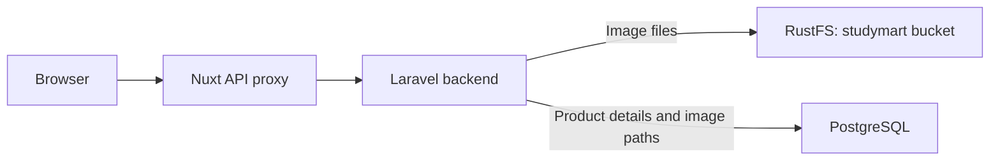

# Local object storage

StudyMart stores product images in **RustFS**, an S3-compatible object storage service running in Docker. Laravel uploads, reads, and deletes the files through the Flysystem S3 adapter. PostgreSQL stores the object paths in each product's `images` field.

This setup runs on your computer and uses your local disk. The credentials belong to the local RustFS service; an AWS account is unnecessary.

## How it works



Objects use paths such as `product-images/generated-filename.jpg`. Laravel returns image URLs such as `/api/products/12/images/0`, and streams the file from RustFS when that URL is requested. The frontend does not receive storage credentials.

## Services and addresses

These are the default addresses. The port variables in the root `.env` can change the host ports.

| Service | Address or setting |
| --- | --- |
| Application | <http://localhost:3000/admin> |
| Laravel API | <http://localhost:8000/api/products> |
| RustFS console | <http://localhost:9001/rustfs/console/> |
| S3 endpoint from your host / WSL | `http://localhost:9000` |
| S3 endpoint from the backend container | `http://object-storage:9000` |
| Bucket | `studymart` |
| Object prefix | `product-images/` |
| Docker volume | `object_storage_data`, mounted at `/data` |
| RustFS image | `rustfs/rustfs:1.0.1` |

Docker Compose normally prefixes the volume name with the project name, for example `coe-aimanasrn_object_storage_data`. The published ports bind to `127.0.0.1` for local access.

## Run with Docker

Run the commands in this guide from the repository root in a Bash / WSL terminal. Docker Engine and Docker Compose must be available to your user.

For a fresh clone, copy the environment examples without overwriting existing files:

```bash
cp -n .env.example .env
cp -n src/backend/.env.example src/backend/.env
```

In the **root `.env`**, configure:

```dotenv
OBJECT_STORAGE_ACCESS_KEY=studymartlocal
OBJECT_STORAGE_SECRET_KEY=replace_with_your_generated_secret
OBJECT_STORAGE_BUCKET=studymart
OBJECT_STORAGE_PORT=9000
OBJECT_STORAGE_CONSOLE_PORT=9001
```

Generate a secret with `openssl rand -hex 24` and paste the result into `OBJECT_STORAGE_SECRET_KEY`. Keep the root PostgreSQL settings configured as well. Existing installations already have their credentials in `.env`; keep those values when restarting.

Start the application:

```bash
docker compose up -d --build
docker compose ps
```

The backend waits for PostgreSQL and RustFS to become healthy. Its entrypoint installs Composer dependencies, clears the configuration cache, ensures an application key exists, runs migrations, and initializes local storage before starting Laravel.

The S3 adapter is already declared in `src/backend/composer.json` and locked in `composer.lock`. Docker installs it automatically. For a host-run backend, run `composer install` from `src/backend`.

## Sign in to the console

Open <http://localhost:9001/rustfs/console/> and select **Key Login**:

| Login field | Value from the root `.env` |
| --- | --- |
| Access Key | `OBJECT_STORAGE_ACCESS_KEY` (default: `studymartlocal`) |
| Secret Key | `OBJECT_STORAGE_SECRET_KEY` |

Open the `studymart` bucket to inspect its `product-images/` objects. Use the full console URL above; the bare `http://localhost:9001/` path can return `403 AccessDenied` with this pinned version.

The actual `.env` files are ignored by Git. Commit configuration examples without copying real credentials into them.

## Laravel environment and filesystem configuration

Docker Compose injects the following backend settings using the root `.env`:

| Backend variable | Docker value |
| --- | --- |
| `PRODUCT_IMAGES_DISK` | `s3` |
| `OBJECT_STORAGE_INITIALIZE` | `true` |
| `AWS_ACCESS_KEY_ID` | Root `OBJECT_STORAGE_ACCESS_KEY` |
| `AWS_SECRET_ACCESS_KEY` | Root `OBJECT_STORAGE_SECRET_KEY` |
| `AWS_DEFAULT_REGION` | `us-east-1` |
| `AWS_BUCKET` | Root `OBJECT_STORAGE_BUCKET`, default `studymart` |
| `AWS_ENDPOINT` | `http://object-storage:9000` |
| `AWS_USE_PATH_STYLE_ENDPOINT` | `true` |

These Docker settings take precedence over values in `src/backend/.env`.

If Laravel runs **directly on your host / WSL**, keep RustFS running with `docker compose up -d object-storage` and set these values in **`src/backend/.env`**:

```dotenv
FILESYSTEM_DISK=local
PRODUCT_IMAGES_DISK=s3
AWS_ACCESS_KEY_ID=studymartlocal
AWS_SECRET_ACCESS_KEY=replace_with_the_same_root_storage_secret
AWS_DEFAULT_REGION=us-east-1
AWS_BUCKET=studymart
AWS_ENDPOINT=http://localhost:9000
AWS_USE_PATH_STYLE_ENDPOINT=true
```

Match the access key, secret, bucket, and host port to the root `.env`. Keep the host backend's PostgreSQL connection configured separately. Clear Laravel's cached configuration after editing its environment:

```bash
cd src/backend
php artisan config:clear --no-interaction
cd ../..
```

[`config/filesystems.php`](src/backend/config/filesystems.php) contains both the `s3` disk and the `product_images_disk` setting. Product operations explicitly use `product_images_disk`; changing `FILESYSTEM_DISK` alone does not switch product images. Other default filesystem operations continue using `FILESYSTEM_DISK`.

The S3 disk reads its endpoint, bucket, credentials, region, and path-style option from the `AWS_*` variables above. The configured region is an S3 client setting for this local service.

## Bucket creation and existing image import

The backend entrypoint runs this command automatically because Docker sets `OBJECT_STORAGE_INITIALIZE=true`:

```bash
docker compose exec backend php artisan storage:initialize-local --import-local --no-interaction
```

The command:

1. Creates the configured bucket if it does not exist.
2. Reads the image paths referenced by products in PostgreSQL.
3. Copies available files from `src/backend/storage/app/public/` to the same paths in RustFS.
4. Skips objects already in the bucket and paths whose local source file is missing.
5. Keeps the original local files in place.

Repeated runs do not overwrite existing objects. Files unreferenced by products are not imported. Without `--import-local`, the command only ensures the bucket exists. It is allowed in the `local` and `testing` environments and rejects other environments.

## Test uploads through the application

1. Start the stack and open <http://localhost:3000/admin>.
2. Create a temporary product with an image and save it.
3. Confirm that the image displays and that an object appears under `studymart/product-images/` in the RustFS console.
4. Edit the product to remove or replace the image, and verify the gallery updates.
5. Delete the temporary product and confirm its remaining objects are removed from the bucket.

Uploads accept JPG, JPEG, PNG, and WebP images, up to 5 MiB per image and six images per product, including retained images.

For API clients, create products with `POST /api/products` using `multipart/form-data` and `images[]` file fields. Required product fields are `category_id`, `sku`, `name`, `price`, and `stock_quantity`; use an existing category and a unique SKU. For multipart updates, send `POST /api/products/{product}` with `_method=PUT`. `retained_images` accepts a JSON array of the image indexes to keep, such as `[0,1]`; omitting it preserves existing images.

### Automated tests

The storage-related tests are:

- [`ProductImagesTest.php`](src/backend/tests/Feature/ProductImagesTest.php): configured disk selection, uploads, image responses, updates, deletion, and validation.
- [`LocalObjectStorageTest.php`](src/backend/tests/Feature/LocalObjectStorageTest.php): bucket creation, repeatable import, preserving existing files, and environment/configuration checks.

The tests fake filesystem operations and mock the S3 client. Use the application checks above to verify the actual RustFS connection.

Use a **separate PostgreSQL test database**. The current product migration uses PostgreSQL `ALTER TABLE ... ADD CONSTRAINT` statements that fail with the default SQLite test configuration. The following commands create a temporary database, run the targeted tests, then remove it. Choose a dedicated test database name and never use the application database for these tests, because the test runner rebuilds its schema.

```bash
docker compose exec -T postgres sh -c 'createdb -U "$POSTGRES_USER" studymart_storage_test'

docker compose exec -T \
  -e APP_ENV=testing \
  -e DB_CONNECTION=pgsql \
  -e DB_DATABASE=studymart_storage_test \
  -e CACHE_STORE=array \
  -e SESSION_DRIVER=array \
  -e QUEUE_CONNECTION=sync \
  backend php artisan test --compact \
  tests/Feature/ProductImagesTest.php \
  tests/Feature/LocalObjectStorageTest.php

docker compose exec -T postgres sh -c 'dropdb -U "$POSTGRES_USER" studymart_storage_test'
```

Implementation verification on 15 October 2026 passed **11 tests with 72 assertions**. A real multipart upload through the frontend API also passed: Laravel returned the exact uploaded image bytes, the local public directory was unchanged, and deleting the temporary product removed its object. Both existing product images were imported and remained accessible.

## Daily operations and troubleshooting

```bash
# Check services and storage health.
docker compose ps
curl --fail http://localhost:9000/health

# Inspect startup and storage errors.
docker compose logs --tail=100 backend object-storage

# Apply changed root credentials or Docker environment settings.
docker compose up -d --force-recreate object-storage backend

# Stop containers while keeping stored files and the database.
docker compose stop

# Start the stack again.
docker compose up -d
```

| Symptom | Check |
| --- | --- |
| Console root returns `403 AccessDenied` | Open `/rustfs/console/` on port 9001. |
| Key Login fails | Use the current root `.env` storage credentials; recreate the service after changing them. |
| Backend cannot connect | Use `http://object-storage:9000` inside Docker, or `http://localhost:9000` for a host-run backend. Check service health. |
| Missing S3 adapter class | Run `docker compose exec backend composer install --no-interaction`, or rebuild/start the backend if it is not running. |
| Bucket is missing or existing images return 404 | Run `storage:initialize-local --import-local`; check that the source files and product image paths exist. |
| Host ports are already occupied | Change the root storage port variables; also update `AWS_ENDPOINT` for a host-run backend. The internal Docker endpoint stays on port 9000. |
| Tests report SQLite constraint errors | Use the isolated PostgreSQL test commands above. |

The Docker volume preserves objects when containers restart or are recreated. `docker compose down` also preserves named volumes. **Adding `-v` deletes the stack's named volumes, including object storage and PostgreSQL data.** Back up both the bucket contents and database together when preserving a working dataset.

## Implementation files

| File | Responsibility |
| --- | --- |
| [`docker-compose.yml`](docker-compose.yml) | RustFS service, persistent volume, local ports, health check, and backend environment. |
| [Root `.env.example`](.env.example) | Storage settings used by Docker Compose. |
| [Backend `.env.example`](src/backend/.env.example) | Laravel filesystem and S3 environment placeholders. |
| [`composer.json`](src/backend/composer.json) | `league/flysystem-aws-s3-v3` dependency. |
| [`filesystems.php`](src/backend/config/filesystems.php) | S3 connection and product image disk selection. |
| [`docker-entrypoint.sh`](src/backend/docker-entrypoint.sh) | Automatic local storage initialization after migrations. |
| [`InitializeLocalStorage.php`](src/backend/app/Console/Commands/InitializeLocalStorage.php) | Bucket creation and existing image import. |
| [`ProductController.php`](src/backend/app/Http/Controllers/Api/ProductController.php) | Product image upload, streaming, replacement, and deletion. |
